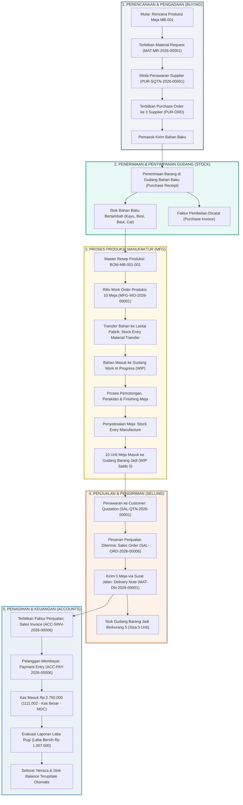
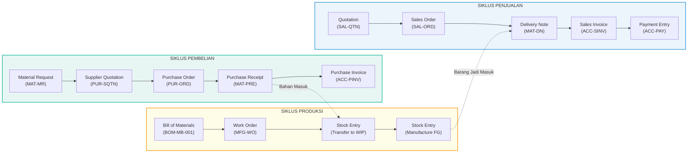
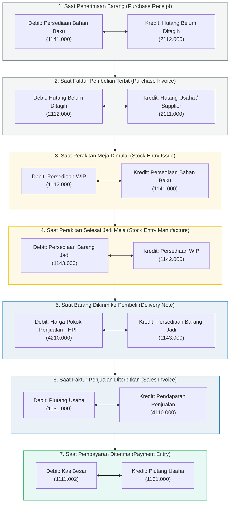

# DIAGRAM ALIR PROSES BISNIS & DOKUMEN MANUFAKTUR (FLOWCHART)
## IMPLEMENTASI SISTEM ERPNEXT PADA MELI DWI COMPANY (MDC)
### Studi Kasus: Produksi Meja Belajar Kayu Minimalis (MB-001)

Dokumen ini menyajikan visualisasi menyeluruh diagram alir proses bisnis (*Business Process Flowchart*), siklus hidup dokumen ERPNext (*Document Lifecycle*), serta integrasi jurnal akuntansi otomatis (*General Ledger Accounting Flow*).

---

## 1. FLOWCHART UTAMA: SIKLUS END-TO-END INDUSTRI MANUFAKTUR

Diagram ini memetakan koordinasi antar 5 departemen utama: **Perencanaan Produksi**, **Pengadaan (Purchasing)**, **Gudang (Warehouse)**, **Penjualan (Sales)**, dan **Keuangan (Accounting)**.

---

## 2. FLOWCHART HUBUNGAN KETERKAITAN DOKUMEN TRANSAKSI ERPNEXT

Diagram ini menggambarkan relasi turunan (*document lineage*) dari setiap formulir transaksi resmi di dalam modul ERPNext.

---

## 3. FLOWCHART INTEGRASI JURNAL AKUNTANSI OTOMATIS (PERPETUAL GENERAL LEDGER)

Diagram ini memperlihatkan bagaimana mutasi fisik barang secara otomatis dijurnal ke buku besar (*General Ledger*) tanpa perlu entri jurnal manual:

---

## 4. PENJELASAN PENGENDALIAN INTERNAL PADA ALUR DOKUMEN

Sistem alur di atas menerapkan kontrol internal manufaktur (*Internal Control System*):
1. **Three-Way Matching:** Pencocokan 3 arah antara *Purchase Order*, *Purchase Receipt*, dan *Purchase Invoice* mencegah perusahaan membayar barang yang belum diterima atau salah harga.
2. **Standard Costing vs Actual:** *Work Order* membatasi penggunaan bahan baku sesuai resep BOM sehingga pemborosan bahan langsung terdeteksi.
3. **Pemisahan Tugas (Segregation of Duties):** Bagian gudang yang menerima barang fisik (*Delivery Note / Receipt*) terpisah dari bagian akuntansi yang menerbitkan faktur (*Invoice*).
